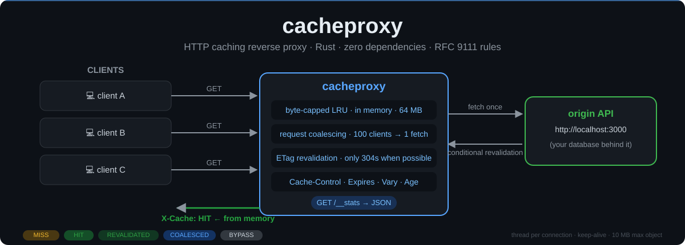
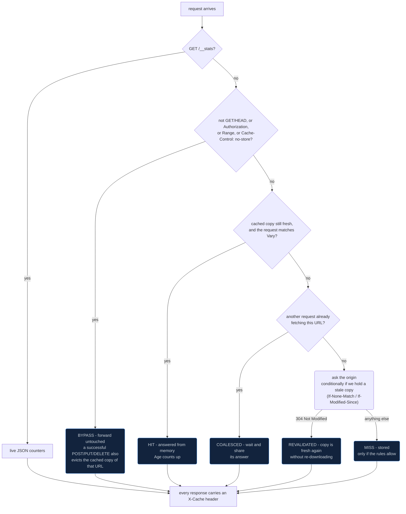

# cacheproxy

<p align="center">
  
</p>

A small HTTP **caching reverse proxy** written in Rust, with **zero dependencies**.

Put it in front of any HTTP API. Repeat requests are answered from memory instead of
going back to the origin, so responses are faster and the origin does less work. It
follows the HTTP caching rules (`Cache-Control`, `Expires`, `ETag`, `Last-Modified`,
`Vary`, `Age`) and reports a live hit ratio.

## Quick start

```bash
cargo run --release -- --origin http://localhost:3000 --port 8080
```

Now call `http://localhost:8080/...` instead of the origin.

```bash
curl -i http://localhost:8080/items/1     # X-Cache: MISS   (fetched from the origin)
curl -i http://localhost:8080/items/1     # X-Cache: HIT    (answered from memory)
curl    http://localhost:8080/__stats     # live counters as JSON
```

Options:

| Option | Default | Meaning |
|---|---|---|
| `--origin <URL>` | required | Origin server, e.g. `http://localhost:3000` |
| `--port <N>` | `8080` | Port to listen on |
| `--bind <ADDR>` | `127.0.0.1` | Address to listen on |
| `--max-cache-mb <N>` | `64` | Cache budget in megabytes |
| `--max-object-mb <N>` | `10` | Largest origin response accepted |
| `--origin-timeout <S>` | `30` | Seconds to wait for the origin |

## How a request is handled



Every response carries an `X-Cache` header with one of those labels.

## Caching rules implemented

| Rule | Behaviour |
|---|---|
| `max-age`, `s-maxage` | Freshness lifetime. `s-maxage` wins (this is a shared cache). |
| `Expires` / `Date` | Used when there is no `max-age`. An invalid `Expires` means "already stale". |
| `no-store`, `private` | Never stored. |
| `no-cache` | Stored, but revalidated before every reuse (needs an `ETag` or `Last-Modified`). |
| `ETag` / `If-None-Match` | Stale entries are revalidated; a `304` refreshes the copy without re-downloading. |
| `Last-Modified` / `If-Modified-Since` | Same, for servers without ETags. |
| `Vary` | Stored responses only match requests with the same values for the varied headers. `Vary: *` is never stored. |
| `Age` | Added to cached responses; the origin's own `Age` is respected. |
| `Set-Cookie` on a response | Not stored (it is often per-user). |
| Client `Cache-Control: no-cache` / `max-age=0` / `Pragma: no-cache` | Forces revalidation. |
| Client `Cache-Control: no-store` | Bypasses the cache. |
| Client `If-None-Match` | Answered with `304` straight from the cache when the ETag matches. |
| `Authorization`, `Range`, non-GET/HEAD | Bypass: forwarded untouched, nothing stored or served from cache. |
| Status codes | `200 203 204 301 308 404 410` can be stored (and only with explicit freshness or a validator). |
| `Content-Length` conflicts, `Transfer-Encoding` + `Content-Length` | Rejected (blocks request smuggling). |

A response with no usable freshness information **and** no validator is not stored at all:
the proxy does not guess with heuristic freshness.

## Extra features

- **Request coalescing.** If 100 clients ask for the same uncached URL at the same moment,
  only one request goes to the origin and everyone shares the answer. This protects the
  origin from a thundering herd.

  ```mermaid
  sequenceDiagram
      autonumber
      participant A as client A
      participant P as cacheproxy
      participant B as client B..N
      participant C as any client, later
      participant O as origin
      A->>P: GET /items/1
      B->>P: GET /items/1
      Note over P: one leader takes the flight
      P->>O: GET /items/1
      O-->>P: 200 · max-age=60
      P-->>A: 200 · X-Cache: MISS (stored in LRU)
      P-->>B: 200 · X-Cache: COALESCED (shared answer)
      Note over C,O: afterwards, while the copy is fresh
      C->>P: GET /items/1
      P-->>C: 200 · X-Cache: HIT (nothing sent to the origin)
      Note over C,O: after max-age runs out, and we hold an ETag
      C->>P: GET /items/1
      P->>O: GET /items/1 · If-None-Match: "v1"
      O-->>P: 304 Not Modified
      P-->>C: 200 · X-Cache: REVALIDATED (body never re-downloaded)
  ```
- **Byte-capped LRU.** Written from scratch: a slab plus an index-linked list, O(1) for
  `get`, `insert` and `remove`. The cap is in bytes, not in number of entries.
- **Zero-copy hits.** Bodies are reference counted, so a HIT does not copy the payload.
- **Stats endpoint.** `GET /__stats` returns JSON:

```json
{"requests":5,"hits":2,"misses":1,"revalidated":0,"coalesced":0,"bypass":0,
 "origin_requests":1,"origin_errors":0,"hit_ratio":0.6667,
 "entries":1,"bytes":247,"max_bytes":67108864,"evictions":0}
```

`hit_ratio` is `hits / (hits + misses + revalidated + coalesced)`.

## Project layout

```
src/
  cache_control.rs  parse Cache-Control values
  httpdate.rs       parse/format HTTP dates (all three legacy formats)
  lru.rs            byte-capped LRU cache
  policy.rs         may this response be stored, and for how long?
  entry.rs          one cached response + freshness / Vary maths
  http.rs           minimal HTTP/1.1 reader and writer, with limits
  upstream.rs       the Upstream trait + a plain-HTTP origin client
  proxy.rs          the HIT / MISS / REVALIDATED / COALESCED logic
  server.rs         TCP listener, thread per connection, keep-alive
  stats.rs          counters
  main.rs           command line
tests/integration.rs   end-to-end tests over real sockets
examples/bench.rs      benchmark: direct vs through the proxy
```

The origin is behind a trait (`Upstream`) and the proxy takes an injectable clock, so the
core logic is tested with a mock origin and a fake clock: no sleeping, no network.

## Tests

```bash
cargo test                                    # unit tests + end-to-end tests
cargo clippy --all-targets -- -D warnings     # lints
cargo fmt --check                             # formatting
```

CI (`.github/workflows/ci.yml`) runs all three on every push.

## Benchmark

```bash
cargo run --release --example bench
```

The origin is simulated in the same process and sleeps 20 ms per request (like an API with
a database behind it). Clients use a new connection per request. One sample run, from the
sandbox this project was built in (your numbers will differ):

```
2000 requests, 16 client threads, 10 distinct URLs, origin latency 20 ms

| path           | total time | req/s  | avg latency | p95 latency | origin requests |
|----------------|-----------:|-------:|------------:|------------:|----------------:|
| direct to API  |     2.56 s |    781 |    20.45 ms |    21.00 ms |            2000 |
| via cacheproxy |     0.15 s |  13444 |     1.15 ms |     2.73 ms |              10 |

speed-up: 17.2x throughput, origin load cut by 99.5%
```

Only 10 origin requests for 2000 client requests: one per distinct URL, even though 16
threads asked at once (coalescing at work).

This measures the value of caching with a slow origin. It is not a claim about raw proxy
speed against other proxies. Re-run it on your own machine and use your own numbers.

## Design choices and known limits

Honest list of what this version does **not** do yet:

- **No HTTPS to the origin.** The build has zero dependencies, so there is no TLS client.
  Use an `http://` origin, or put a TLS terminator in front. Adding `rustls` behind the
  `Upstream` trait is the natural next step.
- **Thread per connection** (capped at 1024) instead of async I/O. Simple and robust at
  small scale; an async rewrite (tokio/hyper) is a planned step for high connection counts.
- **One new TCP connection per origin request** (`Connection: close`); no connection pool.
- **Whole responses are buffered in memory** (up to `--max-object-mb`); larger origin
  responses become `502`. No streaming and no `Range` caching (ranges bypass the cache).
- **One cached variant per URL.** With `Vary`, a request for a different variant replaces
  the stored one instead of keeping both.
- **Never serves stale content**, so no `stale-while-revalidate` or `stale-if-error`.
- **Memory only.** No disk cache and no persistence across restarts.
- The proxy trusts its configured origin and is not hardened as an internet-facing edge
  server. Bind it to `127.0.0.1` or put it behind something that is.

## License

MIT, see [LICENSE](LICENSE).
